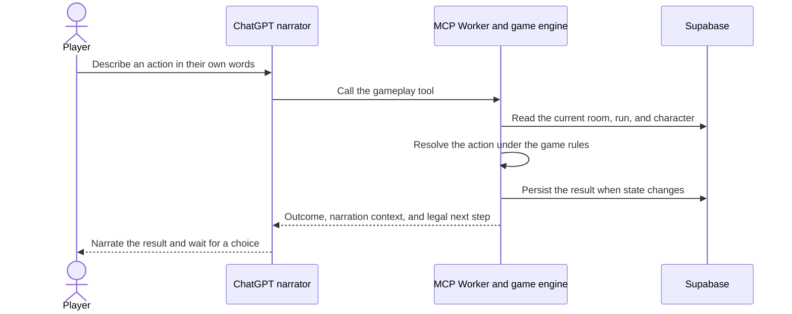

# Dun Dun Dungeon

I built Dun Dun Dungeon as a role-playing game inside ChatGPT. Players describe what they want to do in their own words, explore authored dungeons, and keep their characters and equipment between runs. Players can also build dungeons for others.

[Watch the gameplay demo](https://nate-polland.github.io/dun-dun-dungeon-demo/) · [Read the technical case study](#technical-case-study)

The 11-minute recording shows a new character entering *The Dame in the Rain* and playing through puzzles, hazards, and combat.

## Technical case study

### One turn, from player intent to persistent state

Suppose a player asks whether they can use a prop in the room to get past a hazard. The model interprets their intent using the current room and character context. When the player commits to an action, the model calls an MCP tool with the action and its parameters. A Cloudflare Worker resolves the action against the game's rules and run state. Supabase stores the run and character state. The tool returns the outcome and available next actions, which the model turns into narration.



That division makes an open-ended conversation playable as a game. The model has room to improvise dialogue and describe the scene. The engine decides what a roll means, whether a room is cleared, and when to apply damage or rewards. Authored content gives the narrator the scene, facts to reveal at the right moment, and a voice to sustain across turns.

The same boundary matters when a run ends. The game carries the next operation in the tool response so the host can continue through settlement, trait recording, and eligible loot even if earlier turns have dropped out of context.

### Two development decisions

**Keep first-run coaching when a player resumes.** On a first run, clearing a room can lead to a short coaching exchange before the next room. A recovery path for already-cleared rooms routed straight to the next room, which skipped that exchange. I made recovery return the appropriate next operation for the saved run. A regression test exercises both sync and a repeated choice, for both first-time and returning players, and verifies that recovery writes no new run state or rewards.

The core of the test, abridged to show the behavior:

```js
expect(result.status).toBe('room_already_cleared');
expect(result.next.resume.tool).toBe(firstRun ? 'grimble_tip' : 'take_action');
expect(db.updateRun).not.toHaveBeenCalled();
expect(db.completeRunAndApplyRewards).not.toHaveBeenCalled();
```

**Preserve authored context across MCP clients.** An earlier response format removed some scene and voice context from the structured response to avoid duplicating it in the text response. Clients that passed only structured content to the model then lost information they needed to narrate the room. I changed the Worker to build one narration packet and carry it in both response forms. The transport test checks that the two copies match and that scene context survives across room and boss transitions.

### How I test it

I test the engine rules and tool responses in code, then use live playthroughs to check what the player experiences. The automated tests cover things like whether a displayed option maps to a legal next action and whether a recovery path can apply a reward twice. Playthroughs check whether the narrator sustains the authored voice, gives players enough information to act, and reveals discoveries at the right time. Both layers matter when a correct state transition can still produce a confusing scene.

[Watch a complete gameplay walkthrough](https://nate-polland.github.io/dun-dun-dungeon-demo/) · [Game website](https://dun-dun-dungeon.nathanpolland.workers.dev) · [Support](https://dun-dun-dungeon.nathanpolland.workers.dev/support)
