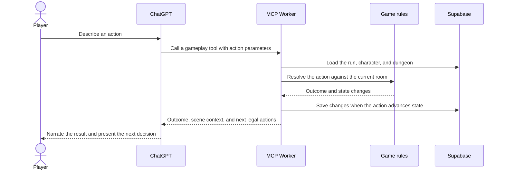

# Dun Dun Dungeon

Dun Dun Dungeon is a persistent role-playing game inside ChatGPT. Players describe actions in their own words, decide whether to press deeper into a dungeon, and carry their characters and equipment between runs. Players can also author dungeons for others.

## Technical architecture

The game separates conversational intent, authored story, and game state. ChatGPT interprets what the player wants to do and narrates the result. A Cloudflare Worker exposes gameplay operations through MCP, and the rules engine determines what happens. Supabase stores the durable state, including characters, dungeon definitions, runs, and rewards.



### MCP is the interface between narration and the game

Consider a player who asks whether a prop in the room could help them get past a hazard. ChatGPT interprets the idea in the context of that room. If the player commits to an action, the model calls the tool with structured parameters. The engine checks the action against the current run and resolves the attempt using the applicable game mechanics. The returned outcome gives ChatGPT the facts it needs to narrate the consequence.

The response also carries a structured `next` instruction. It can tell the host to wait for the player, present a choice, call a follow-up tool, or finish the interaction. A follow-up includes its tool and arguments. After a run ends, the host can use this contract to proceed through settlement, trait recording, and eligible loot even if the earlier conversation has been compacted.

For example, an abridged response for a cleared room on a returning player’s run looks like this:

```json
{
  "status": "room_already_cleared",
  "state": { "action_sequence": 8, "first_run": false },
  "render": { "transition": "room_cleared" },
  "next": {
    "kind": "wait_for_player",
    "resume": {
      "tool": "take_action",
      "arguments": { "run_id": "example-run", "action": "continue" }
    }
  }
}
```

The host can show the room as cleared and wait for the player’s decision. If the player chooses to move on, the response already gives the host the exact next operation.

### Persistent state makes recovery part of gameplay

The game has to handle a player reconnecting, a client retrying, or the model acting on an older turn. The run carries an action sequence. When a request supplies a sequence that no longer matches, the Worker returns a stale-action result. The database update also uses the expected sequence as a condition when advancing it, so competing writes cannot both advance from the same turn.

Recovery has its own behavior. If a room was already cleared, a sync or repeated choice returns the cleared status, current action sequence, and next legal step. On a first run, that can mean routing to between-room coaching. On subsequent runs, it can mean offering to continue. The recovery path does not replay the check or award rewards. A regression test exercises both entry points for both types of run and checks that neither writes to the run or completes it again.

### Authored story travels with the turn

Dungeon content provides the scene, voice, and facts the narrator needs to reveal as play progresses. Game state establishes what has already happened, such as whether a room is cleared or a discovery has been made. The Worker assembles the narration context for the current turn so the model can tell a story grounded in the actual outcome.

One transport change removed scene and voice instructions from the structured response because the text response already carried them. That broke the assumption that the model sees both forms. Some MCP clients supplied only structured content. The Worker now builds one narration packet and includes it in both forms. A transport regression test checks that the copies match and that scene context survives room and boss transitions.

### What I verify before shipping

Automated checks cover game rules, tool responses, state transitions, and recovery. Live playthroughs check things that a state assertion cannot settle on its own, such as whether a room gives players enough information to make a choice, whether discoveries arrive at the right time, and whether the narrator sustains the authored voice.
